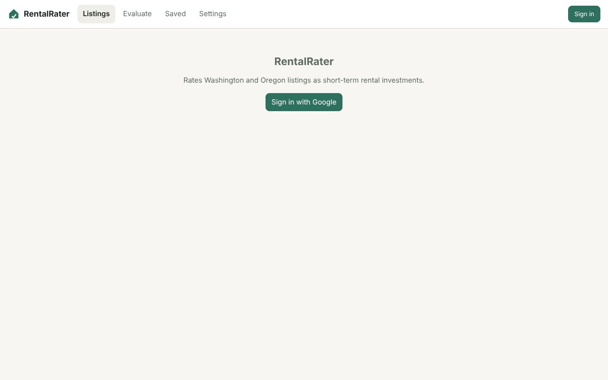

# RentalRater

<!-- site-summary:start -->
<!-- This section is this project's card on https://mendus59.github.io and is copied there daily.
     Keep it true of what's on main: one plain-text summary line (max 160 characters), then 1-6 short bullets.
     See CLAUDE.md ("Site summary"). -->
Rate Washington and Oregon property listings as short-term rental investments, with a Buy, Close or Don't buy verdict for each.

- Browse active for-sale listings in coastal, river and STR-hotspot areas of WA and OR, refreshed monthly from RentCast, each with a verdict and the highest offer that still gets a Buy.
- Compare plans per property: rent it as-is, refurbish, add tiny homes, or build a cabin on land.
- Model financing (DSCR, conventional, land, construction, HELOC, seller financing or cash), startup costs and self-managed or Vacasa management.
- Set your goal: earn back your cash within a set number of years, or just break even on the mortgage while you use the place.
- Rate any Zillow, Redfin or Realtor.com listing with a bookmarklet that fills in the Evaluate form.
- Use it right away as a guest, with saved properties and settings kept in your browser, or sign in with Google to sync them across devices.
<!-- site-summary:end -->

<!-- site-screenshot: docs/screenshot.jpg -->

A static web app (GitHub Pages + Firebase) that rates Washington and Oregon
property listings as short-term rental investments and gives each one a
**Buy / Close / Don't buy** verdict, like:

> Buying this property for $400,000 with $100,000 down on a DSCR loan at 7.5%,
> plus about $97,700 in startup costs, covers the mortgage and expenses with
> about $816/mo left over and earns back your $197,700 in 12.5 years.

## What it does

- **Listings**: pulls active for-sale listings once a month (RentCast free plan),
  filters them by your areas, property types, price and bedrooms, and rates each.
- **Plans per property**: rent as-is, refurbish, add tiny homes, or build a cabin
  on land. It picks the best plan for each listing; you can switch.
- **Financing**: DSCR, conventional (investment / second home, 15 or 30 yr), land,
  construction-to-permanent, HELOC, seller financing, or cash. Rates and terms are
  editable in Settings.
- **Startup costs**: closing, repairs/renovation (by condition), furnishing,
  tiny homes, new build, site prep, well, septic, power, permits, STR license,
  setup, loan points and an operating reserve. Each is estimated from the
  property (size, bedrooms, year built/condition, lot) and the area's cost
  index, and every line can be overridden per property.
- **Management**: self-managed (3% platform fee) or Vacasa at 35% of revenue.
- **Goals**: "earn back my cash within N years" (optionally counting equity),
  or "just break even on the mortgage indefinitely" (own it and use it free).
  Personal-use nights are subtracted from bookable nights.
- **Area data**: nightly rate, occupancy, property tax rate and construction cost
  index for ~23 WA/OR STR markets, plus STR-rule and tiny-home flags. These are
  starting estimates. Override them in Settings with real comps.
- **Max price**: the highest offer price that still gets a Buy.

## Setup

### 1. GitHub Pages
Settings → Pages → Source: **GitHub Actions**. The `Refresh listings and deploy`
workflow publishes the site on every push to `main` and on the monthly refresh.

### 2. Firebase (sign-in + saved data)
The config is in `js/firebase-config.js` (web keys are safe to commit).
In the Firebase console:
1. Build → Firestore Database → Create database (production mode).
2. Firestore → Rules: paste `firestore.rules` and publish.
3. Authentication → Sign-in method: enable **Google**.
4. Authentication → Settings → Authorized domains: add `mendus59.github.io`.

Data layout: `users/{uid}` holds your settings and a `tier` field (for paid tiers
later); `users/{uid}/properties/{id}` holds saved and hand-entered properties.
If `apiKey` is blank or Firebase can't load, the app runs in local mode and saves
to the browser.

### 3. Monthly listings (RentCast)
The key lives in the `RENTCAST_API_KEY` repo secret. `config/searches.json`
controls what gets pulled:

- **Filters**: single family, condo, townhouse, manufactured and land, under
  $1M, within 10 miles of the Pacific, Puget Sound, Hood Canal, the Strait of
  Juan de Fuca, the Columbia River or Lake Chelan (`js/geo.js` has the rough
  shorelines). Multi-family and apartments are left out.
- **Regions**: 15 coastal/river areas plus 4 inland STR hotspots where the
  water rule is lifted (Rainier, Mt Hood, Bend/Sunriver/Sisters, Methow).
  Seattle/Tacoma/Everett, Portland/Vancouver and Leavenworth are left out on
  purpose; the reasons are listed in the file and shown in the app.
- **Budget**: the free plan gives 50 calls/month and each call returns up to
  500 listings. One run on the 1st of each month refreshes every region (about
  45 calls for ~9,000 listings). If it runs out, the regions it missed go first
  next month.

Run "Refresh listings and deploy" from the Actions tab to fetch immediately.

### 4. Bookmarklet
The Evaluate tab has a "Rate on RentalRater" button to drag to your bookmarks
bar. Click it on any Zillow, Redfin or Realtor.com listing and it opens the
Evaluate form filled in from that page.

## Data sources and limits
- Zillow, Redfin and Realtor.com forbid scraping, so RentalRater doesn't.
  RentCast licenses MLS-sourced listing data and has a free tier.
- No free source publishes STR nightly rates or occupancy (AirDNA, PriceLabs and
  Mashvisor are paid), so area numbers are built-in estimates you can override.
- Zoning / STR / tiny-home flags are general heads-ups, not legal advice.

## Development
No build step. Serve the folder (`python3 -m http.server`) and open it.
Tests: `node --test tests/*.test.mjs`.

- `js/calc.js` evaluation engine (pure functions)
- `js/defaults.js` financing options, cost parameters, default settings
- `js/markets.js` WA/OR area data
- `js/store.js` Firebase / local storage
- `js/app.js` UI
- `scripts/fetch-listings.mjs` monthly RentCast fetch
